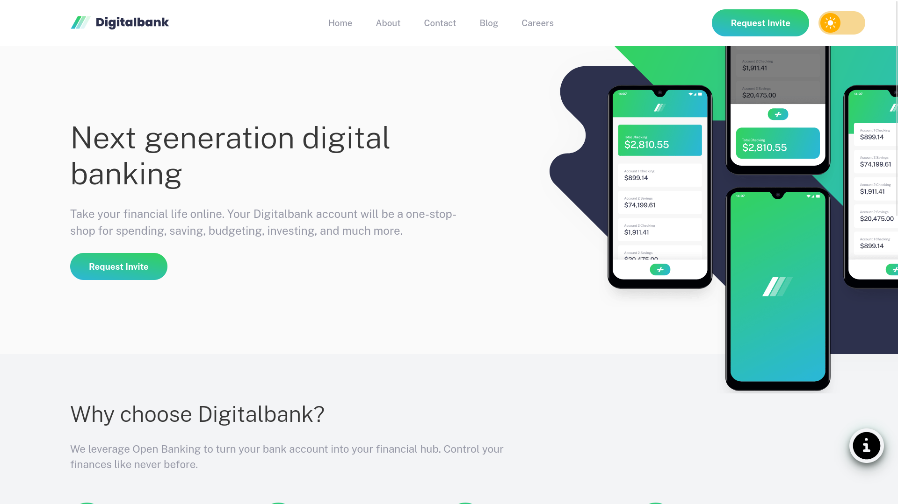
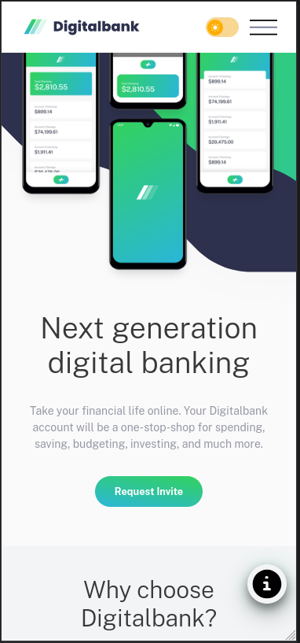

# Digital Bank Landing Page

This is one of my Frontend Mentor challenge projects.

## Links

This is the challenge - [Digital Bank Landing Page](https://www.frontendmentor.io/challenges/digital-bank-landing-page-WaUhkoDN)

* Live Demo: [Digital Bank Landing Page](https://ruthlesscalm.github.io/fm-digitalbank-landing-page/)
* Solution: [Frontend Mentor Solution](https://www.frontendmentor.io/solutions/-pixel-perfect-fluid-landing-page-and-395400-accessibility-S0TnVjsxuB)

## Preview

* **Desktop**

* **Mobile**

## Features

* Fully fluid and responsive layout (280px to 1920px)
* Accessibility-focused (semantic HTML, focus states, screen reader friendly)
* Dark/Light mode toggle using JavaScript
* Toast notifications for displaying credits

## Tech Stack

* HTML
* CSS
* JavaScript

## Credits / References

* [Joshua Comeau](https://www.joshwcomeau.com/)

  * [Shadow Palette](https://www.joshwcomeau.com/shadow-palette/)
  * [Modern CSS Reset](https://www.joshwcomeau.com/css/custom-css-reset/)
* [Piccalilli - Andy Bell](https://piccalil.li/author/andy-bell/)

  * [Modern CSS Reset](https://piccalil.li/blog/a-more-modern-css-reset/)

## License

This project is licensed under the MIT License.

Feel free to use the code for learning, experimentation, or reference.
